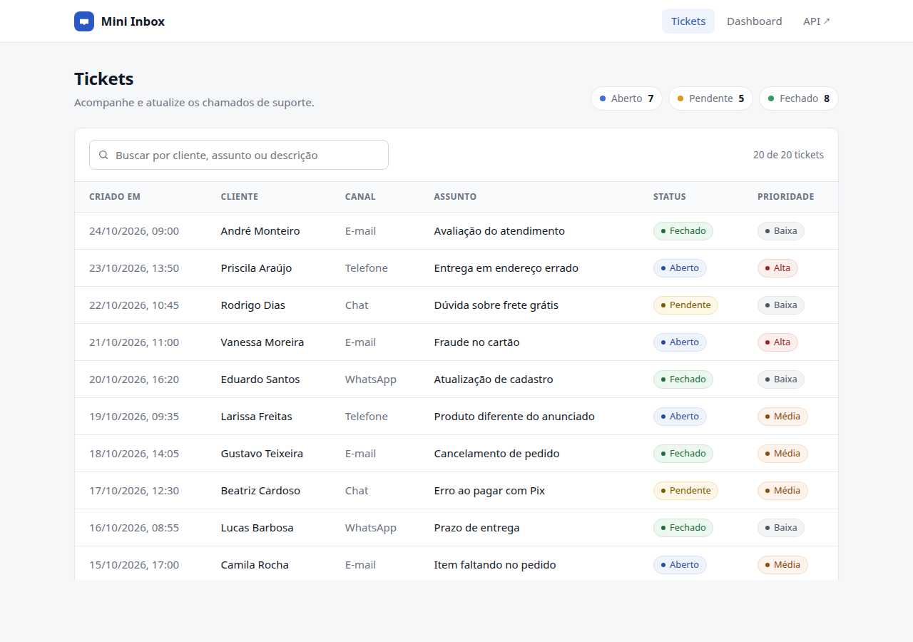
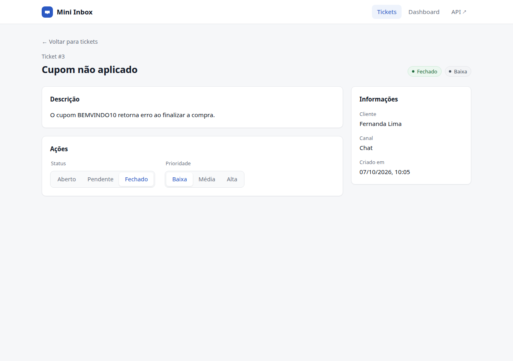
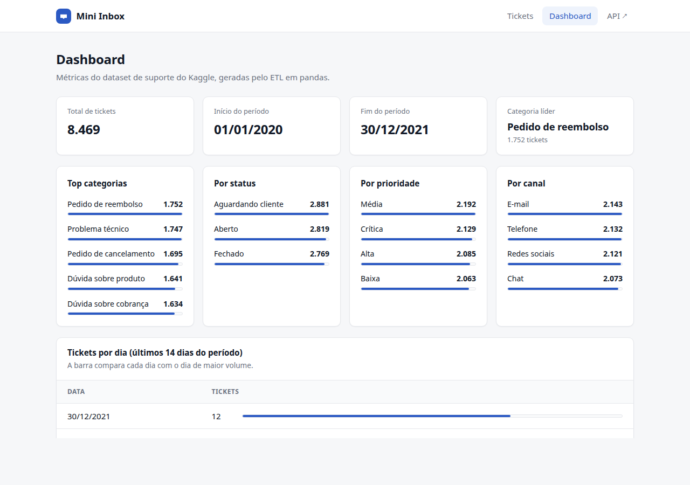
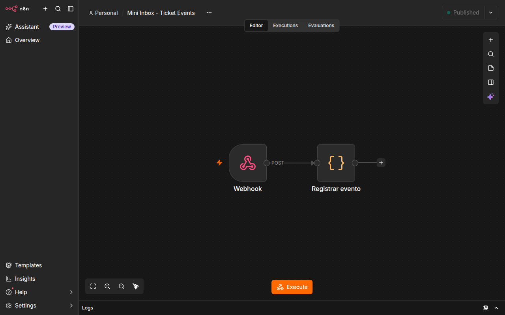
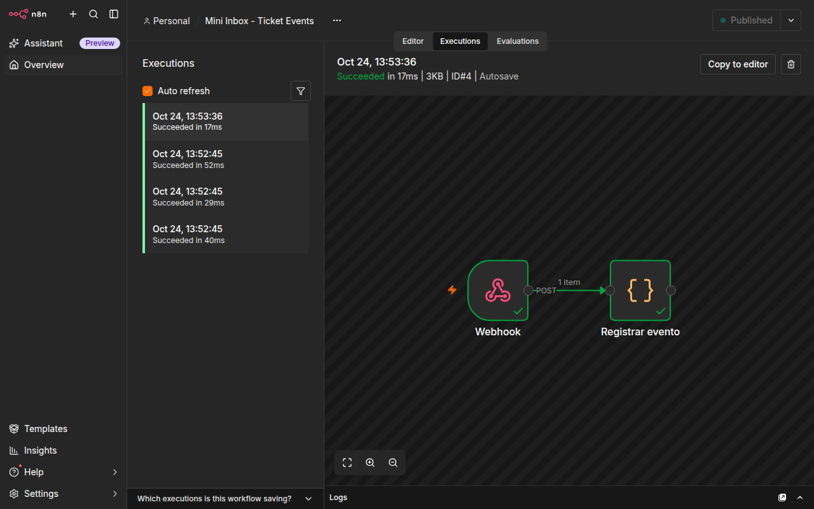

# Mini Inbox

Mini sistema de tickets de suporte: API em FastAPI com SQLite, interface em Next.js, ETL com pandas sobre um dataset do Kaggle e um workflow n8n acionado por webhook. Roda com Docker ou direto na máquina.

## Stack

- Backend: Python 3.12, FastAPI, SQLite
- Frontend: Next.js 16 (App Router) e TypeScript
- Dados: pandas
- Automação: n8n 2.44.6

## Como rodar com Docker

Requisito: Docker com Compose. Para rodar sem Docker, veja a [próxima seção](#como-rodar-sem-docker).

1. Crie o `.env` a partir do exemplo (o `.env` fica fora do Git):

   ```bash
   cp .env.example .env
   ```

   No Windows (PowerShell): `Copy-Item .env.example .env`

2. Suba os serviços:

   ```bash
   docker compose up --build
   ```

| Serviço | URL |
|---|---|
| Frontend | http://localhost:3000 |
| API (docs interativas em `/docs`) | http://localhost:8000 |
| n8n | http://localhost:5678 |

Se alguma porta estiver ocupada, ajuste `FRONTEND_PORT`, `BACKEND_PORT` ou `N8N_PORT` no `.env` e rode o `docker compose up` de novo. Ao mudar a porta do frontend, ajuste também `CORS_ORIGINS`.

Para parar: `docker compose down`.

Na primeira subida:
- O backend cria o `backend/db.sqlite` e insere os 20 tickets de `backend/seeds/tickets.json`.
- O n8n importa e publica o workflow `n8n/workflow.json` automaticamente. No primeiro acesso à interface do n8n ele pede a criação de um usuário local, que não é necessário para o webhook funcionar.

## Como rodar sem Docker

Passo a passo partindo de uma máquina sem nada instalado. São três terminais abertos ao mesmo tempo: backend, n8n e frontend. Neste modo o `.env` não é usado, os valores padrão já apontam para `localhost`.

### 1. Instalar as ferramentas

É preciso ter Git, Python 3.12 e Node.js 22 ou 24.

Ubuntu/Debian:

```bash
sudo apt update
sudo apt install -y git curl unzip python3 python3-venv python3-pip
curl -fsSL https://deb.nodesource.com/setup_22.x | sudo -E bash -
sudo apt install -y nodejs
```

macOS (com [Homebrew](https://brew.sh)):

```bash
brew install git python@3.12 node@22
```

Windows (PowerShell):

```powershell
winget install Git.Git Python.Python.3.12 OpenJS.NodeJS.LTS
```

Feche e abra o terminal depois de instalar, e confira:

```bash
git --version
python3 --version   # no Windows: python --version
node --version
```

### 2. Baixar o projeto

```bash
git clone https://github.com/Claudio-16dv/stalse-fullstack-challenge.git
cd stalse-fullstack-challenge
```

### 3. Backend (terminal 1)

```bash
cd backend
python3 -m venv .venv
source .venv/bin/activate
pip install -r requirements.txt
N8N_WEBHOOK_URL=http://localhost:5678/webhook/ticket-events uvicorn main:app --reload
```

No Windows (PowerShell), dentro de `backend`:

```powershell
python -m venv .venv
.venv\Scripts\Activate.ps1
pip install -r requirements.txt
$env:N8N_WEBHOOK_URL="http://localhost:5678/webhook/ticket-events"
uvicorn main:app --reload
```

A API sobe em http://localhost:8000. Na primeira vez ela cria o `backend/db.sqlite` com os 20 tickets do seed. Sem a variável `N8N_WEBHOOK_URL` tudo funciona, só o webhook não é enviado.

### 4. n8n (terminal 2)

Na raiz do projeto, importe e publique o workflow, depois inicie o n8n. Na primeira execução o `npx` baixa o n8n, o que leva alguns minutos.

```bash
npx -y n8n@2.44.6 import:workflow --input=n8n/workflow.json
npx -y n8n@2.44.6 publish:workflow --id=ticketEventsWf001
npx -y n8n@2.44.6 start
```

O n8n abre em http://localhost:5678. O import e o publish só precisam ser feitos uma vez. Nas próximas vezes basta o `start`.

### 5. Frontend (terminal 3)

Na raiz do projeto:

```bash
cd frontend
npm ci
npm run dev
```

Acesse http://localhost:3000. O frontend chama a API em `http://localhost:8000` por padrão. Se a porta 3000 estiver ocupada, use `npm run dev -- --port 3001`.

### 6. Testar o webhook

Abra um ticket na interface e clique em "Fechado" ou "Alta". No n8n, a execução aparece em Overview > Mini Inbox - Ticket Events > Executions.

### 7. ETL (opcional)

O `metrics.json` já vem no repositório. Para gerá-lo de novo, a partir da raiz do projeto:

```bash
cd data
curl -L -o raw/tickets.zip https://www.kaggle.com/api/v1/datasets/download/suraj520/customer-support-ticket-dataset
unzip -o raw/tickets.zip -d raw
python3 -m venv .venv
source .venv/bin/activate          # Windows: .venv\Scripts\Activate.ps1
pip install -r requirements.txt
python etl.py
```

No Windows, troque o `unzip` por `tar -xf raw/tickets.zip -C raw`.

## ETL (pandas + Kaggle)

Dataset: [Customer Support Ticket Dataset](https://www.kaggle.com/datasets/suraj520/customer-support-ticket-dataset) (8.469 tickets).

O `data/processed/metrics.json` já está versionado, então o dashboard funciona sem rodar o ETL. Para regenerá-lo:

```bash
curl -L -o /tmp/tickets.zip https://www.kaggle.com/api/v1/datasets/download/suraj520/customer-support-ticket-dataset
unzip -o /tmp/tickets.zip -d data/raw
docker compose run --rm etl
```

O script `data/etl.py` lê o CSV, faz o parse de `Date of Purchase` e gera em `data/processed/metrics.json`:
- total de tickets e período
- quantidade de tickets por dia
- top 5 categorias (`Ticket Type`)
- totais por status, prioridade e canal

O backend apenas lê esse arquivo no `GET /metrics`. Se ele não existir ou estiver inválido, responde 503.

## API

| Método | Rota | Descrição |
|---|---|---|
| GET | `/tickets` | Lista os tickets, do mais recente para o mais antigo |
| GET | `/tickets/{id}` | Detalhe de um ticket |
| PATCH | `/tickets/{id}` | Altera `status` e/ou `priority` |
| GET | `/metrics` | Conteúdo do `metrics.json` gerado pelo ETL |
| GET | `/health` | Verificação de saúde |

Valores aceitos: `status` em `open`, `pending`, `closed`. `priority` em `low`, `medium`, `high`. `channel` em `email`, `chat`, `whatsapp`, `phone`.

```bash
curl -X PATCH http://localhost:8000/tickets/1 \
  -H "Content-Type: application/json" \
  -d '{"status": "closed"}'
```

## Webhook (n8n)

Quando um `PATCH` faz o ticket passar a `status=closed` ou `priority=high`, o backend envia um `POST` para `N8N_WEBHOOK_URL` (padrão `http://n8n:5678/webhook/ticket-events`).

O envio só acontece quando o valor muda. Fechar um ticket que já estava fechado não dispara nada. Se o `PATCH` fizer as duas mudanças ao mesmo tempo, são enviados dois eventos. A chamada roda em background com timeout de 3 segundos, então uma falha no n8n não afeta a resposta da API.

Exemplo de payload:

```json
{
  "event": "ticket.closed",
  "ticket": {
    "id": 1,
    "created_at": "2026-10-05T09:12:00",
    "customer_name": "Marina Souza",
    "channel": "email",
    "subject": "Pedido não chegou",
    "description": "Fiz o pedido há 10 dias e o rastreio não atualiza desde a postagem.",
    "status": "closed",
    "priority": "high"
  }
}
```

O campo `event` vale `ticket.closed` ou `ticket.high_priority`.

O workflow (`n8n/workflow.json`) tem dois nós: um Webhook `POST /webhook/ticket-events` e um nó Code que monta e registra uma mensagem com o evento. O resultado aparece na aba Executions do workflow.

Para testar direto:

```bash
curl -X POST http://localhost:5678/webhook/ticket-events \
  -H "Content-Type: application/json" \
  -d '{"event":"ticket.closed","ticket":{"id":99,"subject":"Teste","customer_name":"Fulano","status":"closed","priority":"low"}}'
```

## Estrutura

```
backend/
  main.py                 app, CORS, startup
  app/
    config.py             variáveis de ambiente
    database.py           conexão SQLite e schema
    schemas.py            enums e modelos Pydantic
    errors.py             exceções e respostas HTTP
    dependencies.py       injeção de dependências
    routers/              camada HTTP
    services/             regras de negócio, webhook, métricas, seed
    repositories/         acesso ao banco
  seeds/tickets.json
frontend/
  app/                    páginas /tickets, /tickets/[id], /dashboard
  components/             tabela, badges, ações, cards
  lib/                    cliente da API, tipos, labels, formatação
data/
  raw/                    dataset do Kaggle (fora do Git)
  processed/metrics.json
  etl.py
n8n/
  workflow.json
  screenshot.png
screenshots/
docker-compose.yml
```

## Decisões e premissas

O PDF não definia estes pontos, então segui o que está abaixo:
- O ticket tem os campos `id`, `created_at`, `customer_name`, `channel`, `subject`, `description`, `status` e `priority`. Os valores de status, prioridade e canal são os listados na seção da API.
- Adicionei `GET /tickets/{id}`, necessário para a página de detalhe.
- O dataset do Kaggle alimenta apenas as métricas do dashboard. Os tickets da interface vêm do seed.
- O dataset não tem uma data de criação de ticket com variação. A única coluna de data com distribuição ao longo do tempo é `Date of Purchase`, usada para a contagem por dia.
- A busca da tela de tickets filtra no navegador por cliente, assunto e descrição.
- A alteração de status e prioridade usa Server Actions do Next, então o navegador não chama a API diretamente.
- O banco, a API e o `metrics.json` guardam os valores em inglês (`open`, `pending`, `closed`, nomes originais do Kaggle). A tradução para português acontece só na interface, em `frontend/lib/labels.ts`.
- O menu tem um link "API" que abre a documentação interativa (`/docs`) do FastAPI em outra aba.

## Screenshots

| Tickets | Detalhe |
|---|---|
|  |  |



| Workflow n8n | Execuções no n8n |
|---|---|
|  |  |
